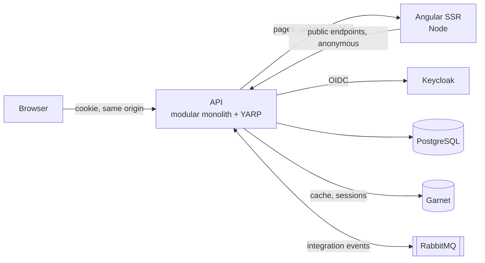

# CloudGround

[](https://github.com/Q-Sharp/CloudGround/actions/workflows/ci.yml)

CloudGround is a `dotnet new` template for container-based .NET solutions. One command creates a
production-shaped solution with a visible architecture: a modular monolith with Minimal APIs, an
Angular frontend with server-side rendering, sign-in with a cookie session that keeps tokens out of
the browser, messaging with a transactional outbox, tests at every level, container images and a Docker Compose deployment.
One more command runs all of it locally through [Aspire](https://aspire.dev).

> **Status:** all seven phases of the first version are built. The package is not on NuGet yet;
> install it from source as shown below.

## Quickstart

Prerequisites: [.NET 10 SDK](https://dotnet.microsoft.com/download), [Node.js](https://nodejs.org)
26 with npm, and Docker or Podman.

```bash
git clone https://github.com/Q-Sharp/CloudGround.git
dotnet pack CloudGround/CloudGround.Templates.csproj --output CloudGround/artifacts
dotnet new install CloudGround/artifacts/CloudGround.Templates.*.nupkg

dotnet new cloudground --name Contoso.Shop
cd Contoso.Shop
dotnet run --project src/Contoso.Shop.AppHost
```

The Aspire dashboard opens in the browser and shows every resource, its logs and its traces. The
`api` resource serves the application; sign in as `alice` with the password `alice`.



## How this was built with AI

This repository is built with an AI coding agent, Claude Code, and steered by written artifacts
that are part of it:

- **Design**: [`docs/superpowers/specs/`](docs/superpowers/specs/) holds the intent, the goals,
  what must not happen, and every decision, marked as the author's, approved, a default or left to
  the builder.
- **Plans**: [`docs/superpowers/plans/`](docs/superpowers/plans/) holds one plan per phase, with its
  tasks, the tests that prove them and the exact values from the design.
- **Rules**: [`AGENTS.md`](AGENTS.md) holds what every change must follow; [`CLAUDE.md`](CLAUDE.md)
  imports it.
- **Decisions**: [`docs/adr/`](docs/adr/README.md) records the repository's own decisions, with the
  alternatives and why they lost.
- **Process**: every test is written first and seen to fail; every phase ends with a review of the
  whole branch by a separate model and lands as a pull request with
  [CI](https://github.com/Q-Sharp/CloudGround/actions/workflows/ci.yml); commits carry the agent's
  co-author trailer in the [history](https://github.com/Q-Sharp/CloudGround/commits/main).

Every generated solution carries the same kind of kit for its own development: rules for agents,
skills that create a module or add a feature, the Angular CLI's MCP server and its own decision
records.

## What a generated solution contains

- an Aspire AppHost with PostgreSQL, Garnet, RabbitMQ and Keycloak containers, and shared service
  defaults (OpenTelemetry, health checks, resilience, service discovery)
- an Angular frontend with server-side rendering per route: public pages rendered on the server
  from the API's anonymous endpoints, a browser-rendered area for signed-in users, Angular
  Material, angular-eslint, unit tests, OpenTelemetry in Node and a Dockerfile
- a modular Minimal API host: `ProblemDetails`, built-in validation, OpenAPI with Scalar, role
  checks on writes, `HybridCache` on Garnet
- sign-in in the API: OpenID Connect against Keycloak, an HttpOnly session cookie with the session
  and its refreshed tokens in Garnet, Angular-compatible XSRF tokens on writes, and bearer tokens
  for clients without a browser, so tokens never reach the browser; the API forwards every page
  request to the frontend, so the browser sees one origin
- *Projects* and *Tasks* sample modules, each with its own schema, EF Core migrations that Aspire
  applies before the API starts, Mapperly mapping and caching on a read path
- modules that meet only through contracts: a contract interface for synchronous calls and an
  integration event that travels from a transactional outbox through RabbitMQ to an idempotent
  handler (Wolverine)
- architecture tests that enforce the module and contract boundaries for whatever modules exist
- unit tests, integration tests that start the whole application through
  `Aspire.Hosting.Testing`, and Playwright end-to-end tests that drive it in Chromium
- container images for every service, tagged with the solution's version: .NET services through
  SDK container publishing on Ubuntu 26.04 chiseled images, the web app from its own Dockerfile
- a Docker Compose deployment from Aspire's publish pipeline, with EF Core migration bundles,
  health checks and restart policies, and the identity provider, TLS and secrets left to
  configuration
- a devcontainer with the .NET SDK, Node and Docker in Docker, so the quickstart also runs in VS
  Code and GitHub Codespaces
- automatic semantic versioning from Git tags (MinVer) and release pull requests (release-please)
- GitHub Actions for build, lint, all test levels, formatting, container images, the Compose check
  and Conventional Commit pull request titles, and Dependabot for NuGet, npm, container images,
  devcontainer features and GitHub Actions
- an AI collaboration kit: `AGENTS.md` with the solution's rules, `CLAUDE.md`, skills that create a
  module and add a feature slice end to end, and the Angular CLI's MCP server
- a README with C4 context and container diagrams and a module map, and 22 architecture decision
  records

## Options

`--sample false` creates the solution without the *Projects* and *Tasks* sample modules and their
pages; the module infrastructure, messaging, the session cookie, the login and the web app's shell
stay, and the add-module skill creates the first module.

The name becomes the namespace, so characters that are not valid there turn into underscores:
`--name my-shop` creates `my_shop.slnx` and the project `my_shop.Api`.

## Test a generated solution

```bash
dotnet test --solution Contoso.Shop.slnx
```

## Working on the template

See [CONTRIBUTING.md](CONTRIBUTING.md) and the
[change-template skill](.claude/skills/change-template/SKILL.md).

## License

[MIT](LICENSE)
