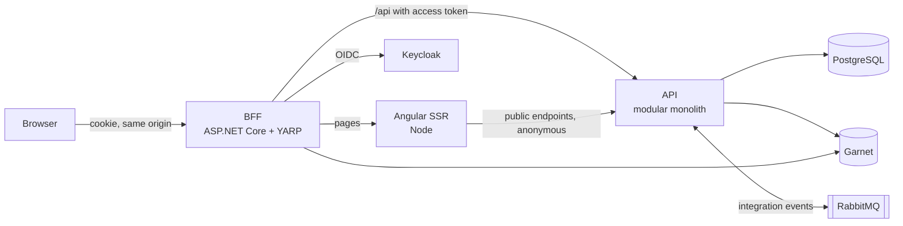

# CloudGround — Design

**Date:** 2026-10-27
**Status:** Draft, awaiting author review
**Repository:** `Q-Sharp/CloudGround` (local at `~/Sources/CloudGround`; public on GitHub from the start, see section 9)

Markers used below: **Author** means the author decided it. **Approved** means it was proposed during
design and the author approved it. **Default** means it was chosen during design without separate
discussion and the author may still override it. **Builder** means it is left to whoever plans and
builds.

---

## 1. Intent

Every new .NET project starts from zero: solution layout, authentication, persistence, logging,
telemetry, tests, CI, container setup. CloudGround is a `dotnet new` template that removes that
start-from-zero work. One command produces a container-based, production-shaped solution with a
visible architecture, and one more command runs all of it locally.

The repository also shows how such a solution is built. It demonstrates two things:

1. Architecture judgment: clear boundaries, deliberate decisions that are written down, and rules
   that are enforced rather than merely described.
2. Productive, controlled AI-assisted development: the AI is steered by explicit rules, recorded
   decisions and automated guardrails, and the repository shows that process openly.

Guiding principle (**Author**): as little custom code as possible, but everything a real project
needs is there. Where Microsoft ships a solution, use it instead of a third-party library.

## 2. Audience and success

- **Audience:** teams, architects and .NET developers who start a new .NET solution, and engineers
  who want to see how a production-shaped solution is built with AI assistance.
- **Success:** a visitor understands within two minutes what CloudGround is, how it is built and how
  AI is used to build it, and the quickstart works on the first try on a clean machine.

## 3. Goals (v1)

1. `dotnet new cloudground -n Contoso.Shop` produces a complete solution.
2. A single command starts everything locally through Aspire, with Docker or Podman as the
   container runtime.
3. The generated solution contains a real sample (see 8.2) that exercises every layer, and a
   template option removes it.
4. The architecture is visible on first contact (README diagrams, ADRs) and enforced by tests.
5. The generated solution ships an AI collaboration kit (see 8.9) so every project created from the
   template starts with the same rules and guardrails.
6. The template repository is itself built with AI, and the evidence is part of the repository
   (specs, plans, ADRs, commit history).
7. CI proves on every push that a freshly generated solution builds and passes its tests.
8. Versions follow SemVer and are determined automatically from the commit history, both for the
   template package and for every generated solution (8.10).

## 4. Non-goals (v1)

- Anything outside this repository. **Author:** repository first.
- Kubernetes manifests, Helm charts, cloud-specific infrastructure as code. **Default.**
- Alternative frontends or a frontend switch. Angular only.
- Microservices. **Author:** the modular monolith is the architecture.
- Multi-tenancy. **Author.**

## 5. Anti-goals

The project fails, even if it technically works, if any of these is true:

- The architecture is not recognizable at first glance. (**Author**)
- HTTP endpoints use controllers instead of Minimal APIs. (**Author**)
- The sample is at "WeatherForecast" level and demonstrates nothing.
- The Angular code uses outdated patterns (NgModules, `*ngIf`/`*ngFor`, zone-based change detection)
  that AI tools still tend to produce.
- The README does not make the point within two minutes, or the quickstart fails on first try.

## 6. Constraints

- C# on .NET 10 (LTS). (**Author:** C#; .NET 10 follows from the version policy below)
- **Version policy (Author):** always the newest LTS version of everything. Where a component has
  no LTS line, the newest stable release. Details in 7.4.
- **Folder layout (Author):** follows the conventions that are widespread on GitHub today for .NET
  and Angular repositories. Concrete layouts in 8.12 and section 9.
- Container-based local runtime. (**Author**)
- Must work with Docker and with Podman.
- Must work on Linux; Windows and macOS should work but are not the author's daily environment.
- Open source, MIT license, everything in English. (**Default**)
- xUnit is mandatory for .NET tests. (**Author**) Version: xUnit v3. (**Default**)
- Microsoft libraries first (**Author**); the only deliberate third-party picks are listed in 7.3.
- Code contains no explanatory comments. Names, small functions and tests carry the meaning.
  Tool directives (`#pragma`, `// eslint-…`) are fine. This is the author's standing rule for all code
  written with AI.

## 7. Decisions

### 7.1 Stack

| Area | Choice | Marker |
|---|---|---|
| Language / runtime | C#, .NET 10 | Author / Approved |
| Orchestration | Aspire (AppHost + ServiceDefaults) | Approved |
| Frontend | Angular, newest stable major (7.4), standalone components, signals, zoneless, built-in control flow | Author (Angular, LTS) / Default (rest) |
| Rendering | Angular SSR with per-route render modes: public pages server-rendered or prerendered, authenticated area client-rendered | Approved; follows from the author's requirement that generated apps suit public websites |
| UI components | Angular Material | Default |
| API style | Minimal APIs, one endpoint group per feature | Author |
| Backend shape | Modular monolith with feature slices | Approved |
| Auth | BFF in ASP.NET Core, cookie session, OpenID Connect against Keycloak | Approved |
| Reverse proxy in BFF | YARP | Approved |
| Database | PostgreSQL with EF Core (Npgsql) | Approved |
| Cache | `HybridCache` backed by Garnet (Microsoft, MIT, Redis-compatible), accessed through the Redis client | Author |
| Messaging | RabbitMQ as broker, Wolverine for messaging with a transactional outbox on EF Core and PostgreSQL | Author |

### 7.2 Microsoft-first library mapping (Author's principle, concrete picks are Defaults)

| Concern | Use | Instead of |
|---|---|---|
| Logging | `Microsoft.Extensions.Logging` exported via OpenTelemetry | Serilog |
| Validation | Built-in Minimal API validation in .NET 10 | FluentValidation |
| OpenAPI document | `Microsoft.AspNetCore.OpenApi` | Swashbuckle |
| Caching | `HybridCache` | custom cache layer |
| HTTP resilience | `Microsoft.Extensions.Http.Resilience` | Polly directly |
| Errors | built-in `ProblemDetails` | custom error format |
| Mediator | none; endpoints call handlers directly | MediatR |
| Reverse proxy | YARP | other proxies |
| E2E browser tests | Playwright | Cypress |

### 7.3 Deliberate third-party picks

| Concern | Library | Marker | Reason |
|---|---|---|---|
| .NET tests | xUnit v3 | Author | mandatory |
| Object mapping | Mapperly | Author | source generator; unmapped members surface at build time and are configured as errors, which is one more guardrail for AI-written code |
| Mocking | FakeItEasy | Default | Microsoft has none; author knows it |
| Identity provider (local) | Keycloak container | Default | open source, realistic OIDC, Aspire integration exists |
| Architecture tests | ArchUnitNET or NetArchTest | Builder | whichever works cleanly with xUnit v3 |
| OpenAPI UI | Scalar, development only | Default | Microsoft ships no UI since .NET 9 |
| Version from tags | MinVer | Author | no version in files; Microsoft has no equivalent |
| Release automation | release-please | Author | changelog, release pull request and tag from Conventional Commits |
| Message broker | RabbitMQ | Author | open source, runs locally and in operation without cloud lock-in, Aspire integration exists |
| Messaging | Wolverine | Author | Microsoft ships no messaging framework; Wolverine provides outbox, inbox, retries, error queues and tracing by configuration under MIT, and can switch to Azure Service Bus by configuration. Used for messaging only; HTTP endpoints still call handlers directly |

### 7.4 Version policy (Author: newest LTS of everything)

| Component | Rule | At the time of writing |
|---|---|---|
| .NET SDK and runtime | newest LTS | .NET 10 |
| Angular | newest stable major. Angular supports every major for about 18 months, so its "LTS" phase is the end of a major's life, not a longer support line; the newest major has the longest support | Angular 22 (**Author**, 2026-10-28: newest version instead of newest LTS) |
| Node.js (SSR, tooling, devcontainer) | newest even-numbered release line, which becomes the next Active LTS | Node.js 26 (**Author**, 2026-10-28; Active LTS since 26.13.0 on 2026-10-28) |
| Container base images | images built on the newest LTS of their distribution, e.g. Ubuntu LTS for .NET images | **Builder** |
| PostgreSQL, Keycloak, RabbitMQ, Garnet, Aspire, NuGet and npm packages | no LTS line in the open-source edition: newest stable release | **Builder** |
| `Aspire.Hosting.EntityFrameworkCore` | preview, because Aspire's migration integration has no stable release yet | **Author** exception (2026-10-28) |
| `Aspire.Hosting.Keycloak`, `Aspire.Keycloak.Authentication` | preview, because Aspire's Keycloak integrations have no stable release yet | **Author** exception (2026-10-28) |

- Dependabot (GitHub's built-in updater) keeps NuGet, npm, container image and GitHub Actions
  versions current, grouped into few pull requests. It is configured not to propose major updates
  for components that follow an LTS line. Moving to a new LTS major is a deliberate pull request
  with its own ADR. (**Default**)
- The same Dependabot setup ships in every generated solution and is used in the template
  repository. (**Default**)

## 8. What a generated solution contains

### 8.1 Runtime topology



- The browser only ever talks to the BFF. Tokens never reach the browser.
- The BFF owns login, logout and a user-info endpoint, attaches the access token when forwarding
  `/api/*`, and protects state-changing requests with antiforgery that works with Angular's built-in
  XSRF support.
- SSR renders public pages anonymously. It does not need the user's session. When a public page
  needs data, the SSR server calls the API's anonymous public endpoints directly, using Aspire
  service discovery. Routes that need data are server-rendered at request time, not prerendered at
  build time, because no API runs during the image build. (**Default**)
- BFF session state and Data Protection keys are persisted outside the process so the BFF can run
  more than one instance. (**Builder:** Garnet, 2026-10-28.)
- Keycloak keeps its data in a volume like PostgreSQL; the realm file is imported on an empty
  volume (**Author**, 2026-10-28). Locally Keycloak serves plain HTTP and the BFF reaches the API
  over its http endpoint, so a solution works without a trusted developer certificate; the demo
  realm contains a password-grant client for the integration tests only. (**Builder**, 2026-10-28)
- The Aspire AppHost wires all of the above, including a Keycloak realm import with demo users and
  roles, so `dotnet run` on the AppHost is the whole quickstart.

### 8.2 Backend

- One API host composed of modules. Each module owns its endpoints, handlers, persistence and
  contracts. Modules talk to each other only through a module's public contract: synchronously
  through contract interfaces, asynchronously through integration events that are part of the
  contract.
- Integration events go through RabbitMQ with Wolverine. They are written to the outbox in the same
  database transaction as the change that raised them. Handlers are idempotent through Wolverine's
  inbox, failed messages are retried and then moved to an error queue.
- Wolverine compiles handler code at runtime in development (`WolverineFx.RuntimeCompilation`);
  container images use pre-generated code (phase 6). Wolverine needs public handlers, so a module
  exposes them in its `Messaging` namespace and forwards to its internals through an interface.
  Module `DbContext`s keep EF Core's retry on transient failures; publishing through the outbox
  runs as one retriable unit of the execution strategy. (**Builder**, 2026-10-28)
- Each module gets its own database schema. (**Default**)
- Migrations run through Aspire's EF Core migration resource (`AddEFMigrations`) before the API
  starts; in operation they are published as a migration bundle. (**Author**, 2026-10-28)
- Endpoints are Minimal APIs grouped per feature, registered by the module.
- Validation uses .NET 10's built-in Minimal API validation; failures and errors return
  `ProblemDetails`.
- Mapping uses Mapperly with unmapped-member diagnostics as errors.
- Central Package Management (`Directory.Packages.props`), shared `Directory.Build.props`,
  `.slnx` solution format, nullable enabled, warnings as errors, .NET analyzers at a strict level.
- **Sample (Default):** two small modules with one cross-module interaction, so module boundaries and
  architecture tests have something real to enforce. Suggested domain: *Projects* and *Tasks*
  (a task belongs to a project; creating a task checks the project through the Projects contract;
  archiving a project publishes `ProjectArchived`, and the Tasks module closes the project's open
  tasks when it receives it).
  The sample covers: public read endpoint, authorized write endpoints with a role check,
  validation, persistence with migrations, caching on one read path, an integration event through
  the outbox and broker, a public SSR page, an
  authenticated Angular area, and tests at every level. **Builder** may pick a different domain if it
  shows the same things better.
- Template option to omit the sample (**Default** name: `--sample false`). Without it, the solution
  contains no domain modules but keeps the module infrastructure (module registration, messaging, schema
  convention, architecture tests, BFF, auth, observability, Angular shell with login). It still
  builds, runs and passes its tests. Architecture tests are written as rules over whatever modules
  exist, plus a test that module discovery itself works, so they are meaningful from the first
  module on. (**Default**)

### 8.3 Frontend

- Angular CLI project with the current defaults (standalone, zoneless, signals, built-in control
  flow, the CLI's default unit test runner).
- Route-level render modes as in 7.1.
- Calls go to the same origin (`/api/...`, `/bff/...`); no tokens in the browser.
- ESLint via angular-eslint; the build fails on lint errors.
- Containerized with its own Dockerfile (the .NET SDK's container publishing does not cover Node).

### 8.4 Observability

- OpenTelemetry logs, traces and metrics in every .NET service through Aspire ServiceDefaults,
  including the BFF and the YARP hop.
- The Angular SSR server is instrumented with the OpenTelemetry Node SDK and exports via OTLP, so a
  trace continues through Node. (**Default**)
- Locally: Aspire dashboard. In operation: OTLP export to any backend, configured, not hardcoded.
- Logs carry trace IDs so one request can be followed from the BFF to the database, and on through
  an integration event into the handler that consumes it.
- Health checks for every service.

### 8.5 Tests

| Level | Tooling | Runs where |
|---|---|---|
| Unit (.NET) | xUnit v3, FakeItEasy | CI, every push |
| Architecture | xUnit v3 + architecture-test library | CI, every push |
| Integration (.NET) | xUnit v3 + `Aspire.Hosting.Testing` against real containers, including one test that follows an integration event from the outbox through RabbitMQ to its handler | CI, every push |
| Unit (Angular) | Angular CLI default runner | CI, every push |
| End-to-end | Playwright for .NET with xUnit v3, starting the AppHost through `Aspire.Hosting.Testing` | CI (**Builder:** every push or nightly, depending on runtime) |

Architecture tests enforce at least: modules do not reference each other's internals; endpoints do
not use controllers; domain code does not depend on ASP.NET Core or EF Core types where the
module structure says it should not.

### 8.6 Container images and deployment

- .NET services build images with SDK container publishing, no Dockerfiles.
- Aspire's publish step produces a Docker Compose deployment for running the whole stack outside
  development. (**Default**) It is a production baseline, not a demo: the OIDC authority, TLS
  termination and secrets come from configuration that the adopter supplies, and the README documents
  them. Keycloak with the demo realm stays a development concern of the AppHost. CI checks that the
  generated Compose file is valid. It does not run a login flow against it.

### 8.7 CI pipeline (Author: GitHub Actions)

- Every generated solution ships a GitHub Actions workflow: build, all test levels from 8.5, every
  guardrail from 8.9, the Compose validity check from 8.6, and building the container images.
- Pull request titles are checked against Conventional Commits, because pull requests are
  squash-merged and the title becomes the commit message that drives versioning (8.10).
- No deployment and no image push to a registry.

### 8.8 Architecture visibility

- `README.md` of the generated solution: C4 context and container diagrams in Mermaid, the
  module map, and how to run, test and add a feature.
- `docs/adr/`: one ADR per significant decision in sections 7 and 8, written so a reader sees the
  alternatives and why they lost.

### 8.9 AI collaboration kit (inside every generated solution)

- `AGENTS.md`: tool-neutral rules for AI agents and humans. Architecture rules, module boundaries,
  how to add a feature, build and test commands, the Microsoft-first library rule, the
  no-comments rule, Conventional Commits for commit messages and pull request titles, and
  modern-Angular rules that rule out the outdated patterns from section 5.
- `CLAUDE.md`: imports `AGENTS.md` and adds Claude Code specifics only.
- `.claude/`: a skill that creates a new module (registration, schema, contracts, tests) and a skill
  that adds a feature slice to an existing module end to end (endpoint group, handler, persistence,
  mapping, tests, optional UI), both following the rules. Creating a module is required because a
  solution generated with `--sample false` has none. (**Default**)
- MCP configuration for the Angular CLI's MCP server, so agents get current Angular guidance.
- Guardrails the AI must pass, all enforced in CI: warnings as errors, analyzers, formatting check,
  Mapperly diagnostics, architecture tests, ESLint, Conventional Commits check, all test levels.

### 8.10 Versioning (Author: automatic SemVer with release-please and MinVer)

- Conventional Commits decide the version bump: `fix:` raises the patch, `feat:` the minor, and
  `feat!:` or a `BREAKING CHANGE` footer the major version.
- release-please (GitHub Action) keeps a release pull request open with the changelog and the next
  version. Merging it creates the tag `vX.Y.Z` and a GitHub Release.
- MinVer derives the version from the latest tag at build time. No version number is maintained by
  hand, and the build never reads one from a file. release-please keeps its own bookkeeping in
  `.release-please-manifest.json` and, for its `simple` release type, `version.txt`; nothing else
  uses them. Builds between releases get pre-release versions automatically.
- CI computes the version once and applies it to every artifact: assembly versions, the NuGet
  package where there is one, and the tags of all container images, including the Angular SSR image.

### 8.11 Devcontainer (Author)

- Every generated solution ships a devcontainer with the .NET 10 SDK, Node and the Aspire tooling,
  and container access so the AppHost can start its dependencies from inside it.
- It works in VS Code and in GitHub Codespaces, and the quickstart works there exactly as on the
  host: one command runs everything.
- **Builder:** verify it with Docker as the host runtime, and check whether Podman as the host
  runtime works; document the result in the README.

### 8.12 Folder layout of a generated solution (Author: widespread GitHub conventions)

Shown for `dotnet new cloudground -n Contoso.Shop` with the sample. The split into a module project
and a separate contracts project per module is a **Default**; the rest follows the usual
`src/`–`tests/`–`docs/` convention of .NET repositories on GitHub.

```text
Contoso.Shop/
├── .devcontainer/
├── .github/
│   ├── actions/build-and-test/                composite action, reused by the template repo's CI
│   ├── workflows/
│   ├── dependabot.yml
│   └── pull_request_template.md
├── .claude/
├── docs/
│   └── adr/
├── src/
│   ├── Contoso.Shop.AppHost/
│   ├── Contoso.Shop.ServiceDefaults/
│   ├── Contoso.Shop.Api/
│   ├── Contoso.Shop.Bff/
│   ├── Contoso.Shop.Web/                      Angular workspace
│   └── Modules/
│       ├── Contoso.Shop.Modules.Projects/
│       ├── Contoso.Shop.Modules.Projects.Contracts/
│       ├── Contoso.Shop.Modules.Tasks/
│       └── Contoso.Shop.Modules.Tasks.Contracts/
├── tests/
│   ├── Contoso.Shop.Architecture.Tests/
│   ├── Contoso.Shop.Integration.Tests/
│   ├── Contoso.Shop.EndToEnd.Tests/
│   ├── Contoso.Shop.Modules.Projects.Tests/
│   └── Contoso.Shop.Modules.Tasks.Tests/
├── .editorconfig
├── .gitignore
├── AGENTS.md
├── CHANGELOG.md                               maintained by release-please
├── CLAUDE.md
├── Contoso.Shop.slnx
├── Directory.Build.props
├── Directory.Packages.props
├── global.json
└── README.md
```

Angular unit tests live next to their components inside `src/Contoso.Shop.Web/`, as the Angular
CLI does it. A generated solution has no `LICENSE` file; the adopter chooses one.

## 9. The template repository itself

- **Packaging:** a NuGet template package; short name `cloudground`; source name chosen so that
  `-n Contoso.Shop` renames namespaces, projects and folders consistently.
  (**Builder:** package ID; `CloudGround.Templates` suggested.)
- **Repository lifecycle (Author):** `Q-Sharp/CloudGround` is created public on GitHub from the
  start, so GitHub Actions minutes do not count against the account's private-repository quota.
  Every plan phase lands as a pull request with CI visible on it. Until v1 is complete, the README
  states the project's status plainly.
- **CI (GitHub Actions):** pack and install the template, generate a solution with and without the
  sample, and run the generated solution's own workflow steps (8.7) on both, so the template repo
  reuses those steps instead of duplicating them. Status badge in the README.
- **Versioning and release (Author):** the same mechanism as 8.10. Merging the release pull request
  tags the version, and a workflow then publishes the package to NuGet. The author creates the
  NuGet API key and repository secret. Nothing is published on an ordinary push; merging the release
  pull request is the deliberate release step.
- **README (repository):** within the first screen: what it is, the one-command quickstart, the
  topology diagram, and a "How this was built with AI" section linking to the evidence below.
  Prerequisites listed explicitly (.NET 10 SDK, Docker or Podman, Node).
- **Evidence of AI-assisted development:** this design and the implementation plans under
  `docs/superpowers/`, ADRs for the template repository's own decisions, and commit history with
  AI co-author trailers.
- The repository has its own `AGENTS.md` and `CLAUDE.md` for working on the template itself.
- **Community health files:** `LICENSE` (MIT), `CONTRIBUTING.md`, `CODE_OF_CONDUCT.md`,
  `SECURITY.md`, issue templates and a pull request template, so GitHub's community-standards
  checklist is complete. (**Default**)
- **Folder layout (Author: widespread GitHub conventions):**

```text
CloudGround/
├── .github/
│   ├── ISSUE_TEMPLATE/
│   ├── workflows/
│   ├── dependabot.yml
│   └── pull_request_template.md
├── .claude/
├── docs/
│   ├── adr/
│   └── superpowers/
│       ├── specs/
│       └── plans/
├── templates/
│   └── cloudground/                           template content, see 8.12
│       ├── .template.config/template.json
│       ├── CloudGround.App.slnx               becomes Contoso.Shop.slnx when generated
│       └── …                                  src/, tests/, docs/ etc. as in 8.12
├── tests/
│   └── CloudGround.Templates.Tests/           template instantiation tests
├── .editorconfig
├── .gitignore
├── AGENTS.md
├── CHANGELOG.md
├── CLAUDE.md
├── CODE_OF_CONDUCT.md
├── CONTRIBUTING.md
├── CloudGround.Templates.csproj               packs templates/ into the NuGet package
├── CloudGround.Templates.slnx                 packaging project and template tests
├── Directory.Build.props
├── Directory.Packages.props
├── LICENSE
├── README.md
├── SECURITY.md
└── global.json
```

  Two solutions, deliberately. `CloudGround.Templates.slnx` at the root covers packaging and the
  template tests. The template content is itself a complete, buildable solution with its own
  `CloudGround.App.slnx`, `Directory.Build.props` and `Directory.Packages.props`, so it can be
  opened, built and run directly while working on the template. MSBuild uses the nearest
  `Directory.*.props`, so the two sets do not interfere.

  The template's source name is the dotted `CloudGround.App`, not `CloudGround`. The template engine
  replaces derived forms of the source name, such as `CloudGround_App` in Aspire's generated
  `Projects.*` types, only when those forms differ from the plain name.

  **Builder:** if the current dotnet/templating guidance prefers a different name than
  `templates/` for the content folder, follow it.

## 10. Prior art

- Microsoft eShop and the Aspire samples: reference for Aspire composition and Microsoft-first style.

## 11. Left to the builder

- Exact versions within the version policy (7.4): check at build time which releases are the newest
  LTS or newest stable, including the Aspire integrations for Keycloak, Garnet and RabbitMQ.
- Architecture-test library (7.3), BFF session store (8.1), E2E schedule (8.5), package ID (9).
- Sample domain, as long as it demonstrates everything listed in 8.2.
- Keycloak realm details (realm name, demo users, roles).
