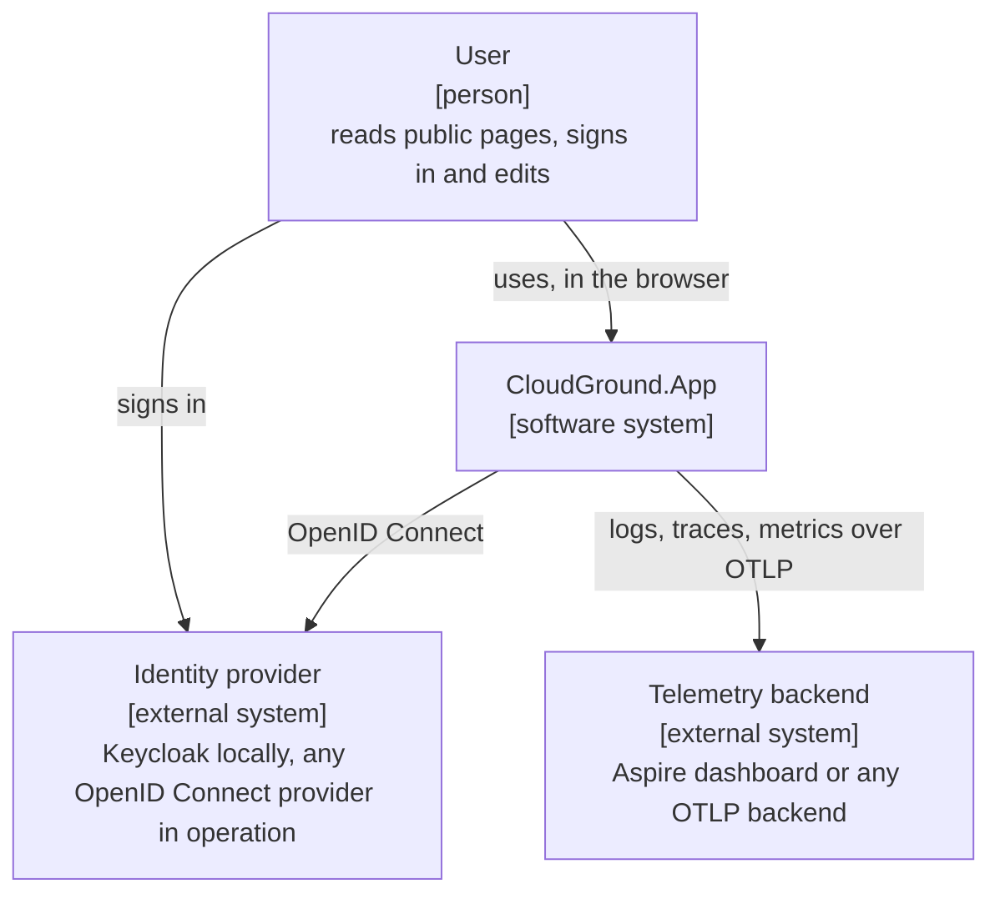
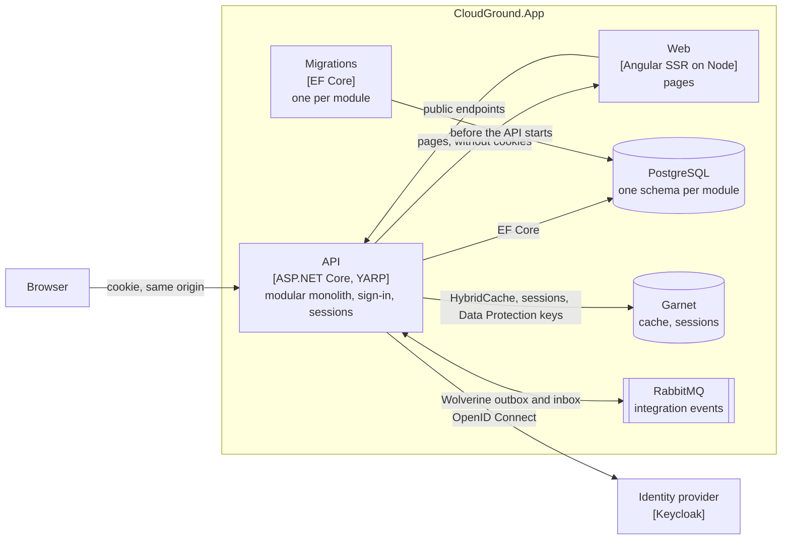
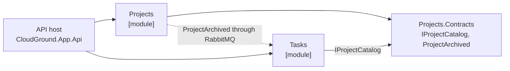

# CloudGround.App

Created with the [CloudGround](https://github.com/Q-Sharp/CloudGround) template.

## Prerequisites

- [.NET 10 SDK](https://dotnet.microsoft.com/download)
- [Node.js](https://nodejs.org) 26 with npm, the version in `src/CloudGround.App.Web/.nvmrc`
- Docker or Podman; the AppHost starts PostgreSQL, Garnet, RabbitMQ and Keycloak as containers

The [devcontainer](#devcontainer) brings all of this except the container runtime on the host.

## Run

```bash
dotnet run --project src/CloudGround.App.AppHost
```

The Aspire dashboard opens in the browser and shows every resource, its logs and its traces.
PostgreSQL, Garnet and Keycloak keep their data in container volumes, so data, sessions and the
realm survive restarts; remove the volume whose name ends in `postgres-data`, `cache-data` or
`keycloak-data` to start over. The integration tests always start without volumes, on an empty
database and a freshly imported realm.
Before the API starts, the AppHost applies the EF Core migrations of every module. In Development
the API serves its OpenAPI document at `/openapi/v1.json` and the Scalar UI at `/scalar`. The
dashboard links the RabbitMQ management UI of the `messaging` resource. The API answers `/health`
(all its checks) and `/alive` (the process only) in every environment, the web app answers
`/health`.

## Architecture

### System context



People use the solution in the browser. They sign in at the identity provider, which the solution
trusts through OpenID Connect. Every service sends its telemetry to an OTLP backend.

### Containers



The browser talks only to the API. The API signs users in, keeps their session in Garnet behind an
HttpOnly cookie and forwards every request that none of its endpoints handles to the web app, so
the browser sees one origin and tokens never reach it. The web app renders public pages on the
server and reads the API's anonymous endpoints directly. The AppHost in
`src/CloudGround.App.AppHost` starts all of these locally and publishes them as a Docker Compose
deployment.

### Module map

<!--#if (sample) -->


The API host registers both modules. *Tasks* asks *Projects* whether a project is active through
`IProjectCatalog` and closes a project's open tasks when it receives `ProjectArchived`. Neither
module references the other; both know only the contracts project.
<!--#else -->
This solution has no modules yet. Create the first with
[the add-module skill](.claude/skills/add-module/SKILL.md).
<!--#endif -->

### Modules

The API host in `src/CloudGround.App.Api` is a modular monolith. It owns the cross-cutting
concerns: errors as `ProblemDetails`, OpenAPI, sign-in and sessions, `HybridCache` backed by Garnet,
and forwarding pages to the web app. Each module in
`src/Modules/` is a class library that owns its endpoints, handlers, persistence and its own
PostgreSQL schema. A feature slice keeps its request, handler and endpoint in one file, and the
endpoint calls the handler directly. Cached reads skip `HybridCache`'s in-process copy and use
Garnet only, so a change that removes a cache entry is visible on every API instance at once.
Requests are validated by the built-in Minimal API validation, and Mapperly maps entities to
responses; a response member without a source fails the build.

Modules meet only through contracts. A module that offers something to others has a
`*.Contracts` project with interfaces and integration events, and other modules reference only
that project. Synchronous calls go through contract interfaces, reactions through integration
events.
<!--#if (sample) -->
The *Projects* and *Tasks* sample modules show both with `IProjectCatalog` and `ProjectArchived`.
<!--#endif -->

The architecture tests in `tests/CloudGround.App.Architecture.Tests` enforce these rules for every
module they find:

- every module project in `src/Modules/` is referenced by the API host
- a module references another module only through its contracts project
- modules do not depend on each other's types
- contracts do not depend on ASP.NET Core, EF Core, Wolverine or any module
- a module exposes only its module class, its request types and the message handlers in its
  `Messaging` namespace
- domain types do not depend on ASP.NET Core or EF Core
- every module's `DbContext` uses a schema named after the module and retries transient failures
- no endpoint is an MVC controller

### Decisions

[`docs/adr/`](docs/adr/README.md) records the significant decisions behind this solution, each with
the alternatives that were considered and why they lost.

## Sign-in

The browser talks only to the API in `src/CloudGround.App.Api`; tokens never reach it. Open the
`api` resource from the dashboard, choose *Log in* and sign in as one of the demo users:

| User | Password | Roles |
|---|---|---|
| `alice` | `alice` | `editor` |
| `bob` | `bob` | none |

The API signs users in with OpenID Connect against Keycloak, with the authorization code flow and
PKCE, and offers:

- `GET /account/login?returnUrl=/path` starts the login and returns only to local paths
- `POST /account/logout` ends the session at the API and at Keycloak
- `GET /account/user` returns the user's name and roles, or 401

Sign-in uses pushed authorization requests when the identity provider offers them, as Keycloak does,
so the browser's redirect carries only a reference to the authorization request.

A signed-in browser holds only an HttpOnly session cookie. The session ticket with the user's tokens
and the Data Protection keys live in Garnet, so several API instances share the same sessions; the
integration tests run two of them. The API refreshes the access token a minute before it expires and
signs the user out when Keycloak refuses the refresh, so a session lasts as long as the identity
provider's session. With the local realm it ends after 30 minutes without requests
(`ssoSessionIdleTimeout`) and at the latest 10 hours after sign-in (`ssoSessionMaxLifespan`), also
while someone is working, and a user blocked in Keycloak loses access within the access token's
lifetime of 5 minutes (`accessTokenLifespan`). In operation the operator's identity provider sets
these times, not the template. Parallel requests of one session may refresh at the same time with
the same refresh token, so the realm keeps used refresh tokens valid (`revokeRefreshToken: false`);
turning rotation on needs a lock around the refresh first. While Keycloak is unreachable, a session
keeps working until its access token expires; after that, the next request signs the user out, and
signing in fails until Keycloak is back. While Garnet is unreachable, requests with a session cookie
count as anonymous: public pages and anonymous API calls keep working, endpoints that need a user
answer 401, and the same cookie works again once Garnet is back with its data. The API never
forwards the tokens; they only keep the session alive.

For a signed-in user, the API sets a readable `cloudground-app-xsrf` cookie and expects its value in
the `X-XSRF-TOKEN` header on every state-changing request with the session cookie, which is what
Angular's `HttpClient` does on its own; the logout form sends it as a form field. Every cookie of the
solution starts with `cloudground-app-`, so two solutions on `localhost` keep their own sessions.

Clients without a browser call the API with Keycloak access tokens for the `cloudground-app-api`
audience in an `Authorization: Bearer` header; a request with that header is authenticated by its
token alone and needs no XSRF token. Reads are anonymous; every write endpoint requires the policy
of its module (`<Module>Policies.Edit`), which requires the `editor` realm role. A test reads the
OpenAPI document and checks that every write endpoint rejects anonymous callers.

The realm lives in `src/CloudGround.App.AppHost/Realms/realm.json` and is imported
when Keycloak starts on an empty volume; after editing the file, remove the `keycloak-data`
volume. The realm is for local development only: it accepts any redirect URI and contains the
`cloudground-app-tests` client, which lets the integration tests get tokens with a password. Locally
Keycloak serves plain HTTP, so the solution runs without a trusted developer certificate.

## Frontend

The Angular app in `src/CloudGround.App.Web` uses the current Angular defaults: standalone
components, signals, zoneless change detection and Angular Material. The AppHost runs it with
`npm run dev`, and the API forwards every path outside `/api/*` and `/account/*` that none of its
endpoints handles to it, without the browser's cookies, so the browser sees one origin.

<!--#if (sample) -->
Each route chooses its render mode in `src/CloudGround.App.Web/src/app/app.routes.server.ts`, the
sample's routes in `src/CloudGround.App.Web/src/app/projects/projects.routes.server.ts`:
<!--#else -->
Each route chooses its render mode in `src/CloudGround.App.Web/src/app/app.routes.server.ts`:
<!--#endif -->

| Route | Render mode | Content |
|---|---|---|
| `/` | server, per request | home page |
<!--#if (sample) -->
| `/explore` | server, per request | all projects, readable without JavaScript |
| `/projects` | browser | the signed-in area; editors create projects there |
<!--#endif -->
| anything else | server, per request | not-found page with status 404 |

Server-rendered pages are anonymous: the Node server calls the API's public endpoints directly,
found through Aspire service discovery. In the browser the same relative `/api/...` calls reach the
API with the session cookie, and Angular's `HttpClient` sends the XSRF token itself.
Responses fetched during server rendering travel with the page, so the browser does not request
them again. The toolbar shows the signed-in user with a logout button, or a login link that
returns to the current page.

`src/CloudGround.App.Web/src/instrumentation.mjs` starts the OpenTelemetry Node SDK, so the dashboard shows the Node
server's incoming requests and its calls to the API in the same traces as the API.

To work on the app on its own, run `npm ci` once in `src/CloudGround.App.Web`. `npm run dev` serves
it on <http://localhost:4200>; pages that call the API need the AppHost. `npm run build` lints and
builds it, and the build fails on lint errors. `npm test` runs the unit tests.

The Dockerfile builds an image that serves the app with Node as a non-root user on port 8080.
Angular answers only requests for the host names in `NG_ALLOWED_HOSTS` and rejects all others
with 400, and the server renders pages with data from the API at `services__api__http__0`. The
[Compose deployment](#deploy-with-docker-compose) sets both; a container started by hand needs
them too.

## Messaging

The API runs [Wolverine](https://wolverinefx.net) with RabbitMQ as transport. Its durable inbox and
outbox live in the `wolverine` schema, which Wolverine creates and updates itself. A module
publishes an integration event through `IDbContextOutbox<TDbContext>`: the event is stored in the
same transaction as the change that raised it and sent after the commit, so it is neither lost nor
sent for a change that failed. Integration events always travel through RabbitMQ, also when the
handler runs in the same process. A failing handler is retried with growing pauses; after that the
message moves to the error queue.

Delivery is at least once, so every handler must leave the same state when it receives an event
twice. Cross-module checks are not transactions.
<!--#if (sample) -->
In the sample, creating a task asks the Projects module whether the project is active and checks
again after saving, so a task created while its project is being archived ends up closed instead
of open.
<!--#endif -->

## Add a module

[`.claude/skills/add-module/SKILL.md`](.claude/skills/add-module/SKILL.md) lists every step:
copying the module and its test project from the skill's folder, adding both to the solution, and
registering the module in the API and its migrations in the AppHost. With Claude Code, `/add-module`
runs it; other agents and people follow the same file.

## Add a feature

[`.claude/skills/add-feature/SKILL.md`](.claude/skills/add-feature/SKILL.md) adds an endpoint, a
use case or a page to a module end to end: request, handler and endpoint in one file, validation,
persistence and migration, Mapperly mapping, tests at every level and an optional page.
`.claude/skills/add-feature/example/` holds a complete slice to copy. With Claude Code,
`/add-feature` runs it.

## Add an integration event

1. Add a record to the publishing module's `*.Contracts` project.
2. Publish it inside `Database.CreateExecutionStrategy().ExecuteAsync(...)`: begin a transaction, call
   `PublishAsync` on the outbox and then `SaveChangesAndFlushMessagesAsync`. EF Core retries the
   whole unit after a transient database failure; a retried unit can send the event twice, which
   at-least-once delivery allows.
3. In the reacting module, reference the contracts project and add a public static
   `<Event>Handler` with a `HandleAsync` method to the module's `Messaging` namespace. Wolverine
   requires public handlers, so the handler only forwards to an internal service through a public
   interface.
4. In the module's `Add<Module>Module`, register the assembly and the interface with Wolverine:
   `ConfigureWolverine(options => { options.Discovery.IncludeAssembly(...);
   options.CodeGeneration.AlwaysUseServiceLocationFor<TInterface>(); })`.

## Add a migration

Change the model, then use the *Add Migration...* command of the module's migration resource in the
Aspire dashboard, or build and run the pinned `dotnet-ef` from the solution root:

```bash
dotnet build
dotnet tool restore
ConnectionStrings__database="Host=localhost" dotnet ef migrations add <Name> --project src/Modules/CloudGround.App.Modules.<Module> \
  --startup-project src/CloudGround.App.Api --context <Module>DbContext --output-dir Persistence/Migrations
```

The design-time host only needs the connection string to exist; it does not connect.

## Test

```bash
dotnet test --solution CloudGround.App.slnx
```

The end-to-end tests in `tests/CloudGround.App.EndToEnd.Tests` start the whole application and
drive Chromium through Playwright. Their first run downloads Chromium. On a machine without
Chromium's system libraries, install them once after a build:

```bash
pwsh tests/CloudGround.App.EndToEnd.Tests/bin/Debug/net10.0/playwright.ps1 install --with-deps chromium
```

`--filter-not-trait Category=EndToEnd` leaves the end-to-end tests out. CI builds, lints and tests
the web app, runs every test level, end-to-end included, builds the container images and checks the
Compose file on every push.

## Working with AI agents

The solution carries its rules for AI agents with it:

- [`AGENTS.md`](AGENTS.md) holds the rules for every change: architecture, libraries, code,
  Angular, versions and commits. Many coding agents read it directly.
- [`CLAUDE.md`](CLAUDE.md) imports `AGENTS.md` and adds what is specific to Claude Code.
- `.claude/skills/` holds the add-module and add-feature skills; they are Markdown and work by hand
  too.
- [`.mcp.json`](.mcp.json) starts the Angular CLI's MCP server, which gives agents the Angular best
  practices for the installed version and searches the Angular documentation.

CI enforces the guardrails that keep generated code in line: warnings as errors and the .NET
analyzers, the formatting check, Mapperly's diagnostics, the architecture tests, ESLint, Conventional
Commit titles and every test level.

## Deploy with Docker Compose

Aspire's publish pipeline turns the AppHost into a Docker Compose deployment. The Aspire CLI is a
local tool of this solution, so it needs no global install:

```bash
dotnet tool restore
dotnet aspire do push --non-interactive --apphost src/CloudGround.App.AppHost/CloudGround.App.AppHost.csproj \
  --output-path artifacts/compose -- \
  --Parameters:keycloak-url=https://id.example.com --Parameters:api-client-secret=<client secret>
dotnet aspire do prepare-compose --non-interactive --apphost src/CloudGround.App.AppHost/CloudGround.App.AppHost.csproj \
  --output-path artifacts/compose -- \
  --Parameters:keycloak-url=https://id.example.com --Parameters:api-client-secret=<client secret>
docker compose --env-file artifacts/compose/.env.Production --file artifacts/compose/docker-compose.yaml up -d
```

`push` builds an image for the API, the web app and every module's migrations and tags
each with the solution's version from MinVer, for example `api:1.4.0`. Without a container
registry in the AppHost it only tags them locally; to deploy to another machine, push them to your
registry and change the image names in the env file. `prepare-compose` writes
`docker-compose.yaml` and `.env.Production` with image names, ports and parameter values. Aspire
generates the passwords of PostgreSQL, Garnet and RabbitMQ and remembers them under
`~/.aspire/deployments`, so keep `.env.Production` secret and out of Git; `artifacts/` is ignored.

The deployment contains:

- PostgreSQL, Garnet and RabbitMQ; PostgreSQL and Garnet keep their data in volumes. The Compose
  project is named `cloudground-app`, so the volumes are `cloudground-app_postgres-data` and
  `cloudground-app_cache-data` wherever the file was generated; starting it with another project
  name (`docker compose -p`) starts on empty volumes
- one container per module that applies its EF Core migration bundle; they run one after another
  on every `up`, apply only what is missing, and the API starts after the last one succeeded
- the API and the web app; the API serves plain HTTP on port 8080 of the host's loopback interface,
  and nothing else is reachable from outside the Compose network except the dashboard
- health checks for PostgreSQL and RabbitMQ, which the services that need them wait for, and a
  restart policy for every service that keeps running
- Aspire's dashboard on `http://127.0.0.1:18888`, from the released dashboard image of the
  AppHost's Aspire major version, which receives the logs, traces and metrics of every service; it asks
  for the login token that `docker compose logs compose-dashboard` prints.
  Point `OTEL_EXPORTER_OTLP_ENDPOINT` of the services elsewhere to use another OTLP backend

Keycloak is not part of it: the realm in `Realms/realm.json` with its demo users and test client is
for development only. The deployment needs:

| Parameter | Env file | Value |
|---|---|---|
| `keycloak-url` | `KEYCLOAK_URL` | HTTPS address of your Keycloak without a path; the API uses `<address>/realms/cloudground-app` as OpenID Connect authority |
| `api-client-secret` | `API_CLIENT_SECRET` | secret of the `cloudground-app-api` client in your Keycloak; without it Aspire generates a random one and every login fails |

The realm `cloudground-app` needs the realm role `editor` and a confidential client
`cloudground-app-api` with the standard flow, PKCE (`S256`), the redirect URI
`https://<host>/signin-oidc`, the post-logout redirect URI `https://<host>/signout-callback-oidc`
and a mapper that puts the realm roles into its ID tokens as `roles`, as `Realms/realm.json` does.
Clients that call the API with bearer tokens need the audience `cloudground-app-api` and the realm
roles in their access tokens, like the realm's `cloudground-app-tests` client.

Terminate TLS in a reverse proxy in front of the API, on the same host at `127.0.0.1:8080` or as
another service in the Compose network at `api:8080`, and keep the API reachable only through it.
The proxy forwards the original `Host` header and sets `X-Forwarded-Proto: https`; the API trusts
forwarded headers in the deployment (`ASPNETCORE_FORWARDEDHEADERS_ENABLED`), builds its redirect
URIs from them and sends its cookies only over HTTPS. Keep `/health` and `/alive` out of the
proxy's public routes: they run the API's checks against its database, cache and broker on every
call.

## Devcontainer

`.devcontainer/devcontainer.json` describes a container with the .NET 10 SDK, Node 26,
PowerShell, the solution's dotnet tools and its own Docker daemon, so the AppHost starts its
containers inside it and `dotnet run --project src/CloudGround.App.AppHost` works there as on the
host. Open the folder in VS Code with the Dev Containers extension, or in GitHub Codespaces.

The host needs Docker or Podman. With Docker, the CloudGround template's CI builds the container
and runs this solution's tests in it. With rootless Podman 5.8, the Dev Containers CLI builds and
starts it, and the tests pass inside it; in VS Code, set `dev.containers.dockerPath` to `podman`.

## Versioning and releases

Versions follow semantic versioning and come from Git tags through MinVer. Pull request titles
follow [Conventional Commits](https://www.conventionalcommits.org/); they decide the next
version. release-please keeps a release pull request open with the changelog. Merging it tags the
release.

## GitHub setup

release-please opens its release pull request with the workflow's `GITHUB_TOKEN`. Allow that
once per repository, either under *Settings → Actions → General → Workflow permissions → Allow
GitHub Actions to create and approve pull requests*, or with:

```bash
gh api -X PUT repos/<owner>/<repo>/actions/permissions/workflow \
  -f default_workflow_permissions=read -F can_approve_pull_request_reviews=true
```

Use squash merges with the pull request title as the commit message, so the Conventional Commit
title reaches the main branch.
